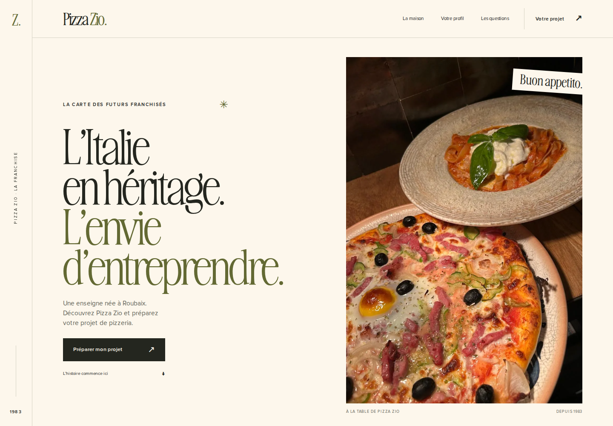
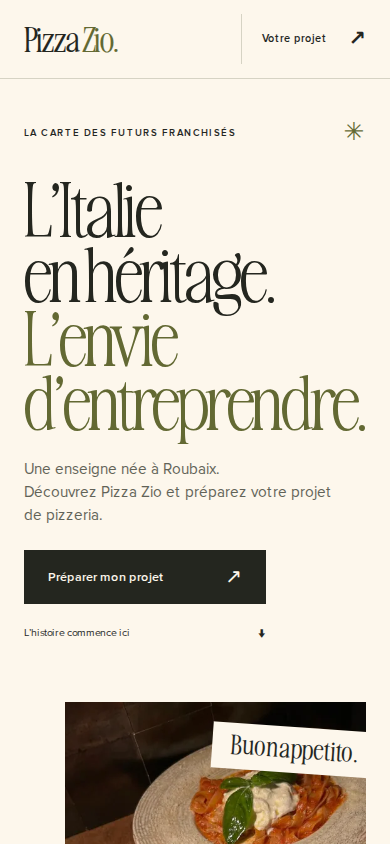

# Pizza Zio — refonte visuelle « La Carte »

Reprise du 28 octobre 2026 à la suite du retour utilisateur sur le premier aperçu. La page adopte une composition de carte imprimée : typographie de l’ancienne landing, photographies existantes, rail marginal, colonnes décalées et filets fins. Le parcours comporte une couverture puis six chapitres.

## Référence effectivement retrouvée

La landing historique https://growth-franchise-zio.vercel.app/ a été ouverte et comparée visuellement. Ses sources utilisent Awesome Serif, Proxima Nova, des photos verticales, un hero vidéo et une palette crème/noir/olive/orange.

L’historique du travail décrit une direction ultérieure « LA CARTE » et des boards ordinateur/mobile dans `strategy/concepts/`, sur le projet local `growth-franchise-zio`. Ces fichiers exacts n’ont pas été retrouvés dans les dépôts accessibles. La refonte reprend donc les principes documentés et les assets vérifiés ; elle ne prétend pas reproduire une maquette Claude non consultée.

## Changements réalisés

- La pizza SVG décorative est remplacée par une photographie de la landing historique. Les photos du restaurant et du service viennent du site officiel ; leurs sources sont consignées séparément.
- Awesome Serif et Proxima Nova sont servies localement. Aucun appel à une police ou un média tiers n’est nécessaire au rendu.
- La page suit un récit distinct : couverture, histoire, profil, formats et conditions, premier échange, questions, préparation du projet. Les répétitions historiques et les grandes sections redondantes ont été regroupées.
- Le CTA fermé indique « Préparer mon projet ». Les informations financières et territoriales inconnues restent explicitement à confirmer. Aucune cible exclusive, promesse de rendement ou donnée commerciale historique n’a été réintroduite.
- Une feuille CSS de 2,35 Ko apporte les entrées, le mouvement discret des photos et la progression du rail. Aucune bibliothèque ni JavaScript d’animation ajouté. Le contenu reste visible et `prefers-reduced-motion` est respecté.
- Le système de réception, la validation, la déduplication et les protections de l’API restent identiques. Seul l’en-tête éditorial du formulaire change.

## Boucles de contrôle

Les revues ont été réparties entre direction artistique, marketing, iconographie, motion et QA. La revue croisée a corrigé une légende historique trompeuse, une formulation familiale non présente dans les données approuvées, un double lien secondaire, une numérotation incohérente et un débordement du titre à 320 px. Aucun contrôle de sécurité ou d’accessibilité n’a été désactivé pour faire passer la refonte.

- Lint, TypeScript, tests serveur/UI et compilation de production : réussis.
- 20 contrôles navigateur : réussis sur ordinateur et mobile, dont images effectivement chargées, dimensions réservées, polices locales, animation et réduction des mouvements.
- Largeurs vérifiées : 320, 390, 621, 700, 768 et 1440 px ; aucun débordement horizontal observé.
- 9 scénarios navigateur → API → Redis → SQLite durable : réussis après adaptation du lanceur à la nouvelle page. Le remplacement de configuration est limité à `LeadForm` dans la copie temporaire, sans modifier les routes de production.

Les tests logiciels ne mesurent pas l’efficacité commerciale de cette direction. Celle-ci reste à confronter à des visiteurs et candidats réels. L’aperçu privé conserve la collecte fermée.

## Polices reprises de la landing historique

Fichiers WOFF2 inchangés, servis depuis `public/fonts/` : `AwesomeSerif-Light.woff2`, `AwesomeSerif-Regular.woff2`, `ProximaNova-Regular.woff2`, `ProximaNova-Semibold.woff2`. Sources : `https://growth-franchise-zio.vercel.app/landing-page/assets/fonts/` suivi de chaque nom. Les droits et crédits existants restent à rattacher aux assets du réseau avant la campagne publique, comme les photographies.
